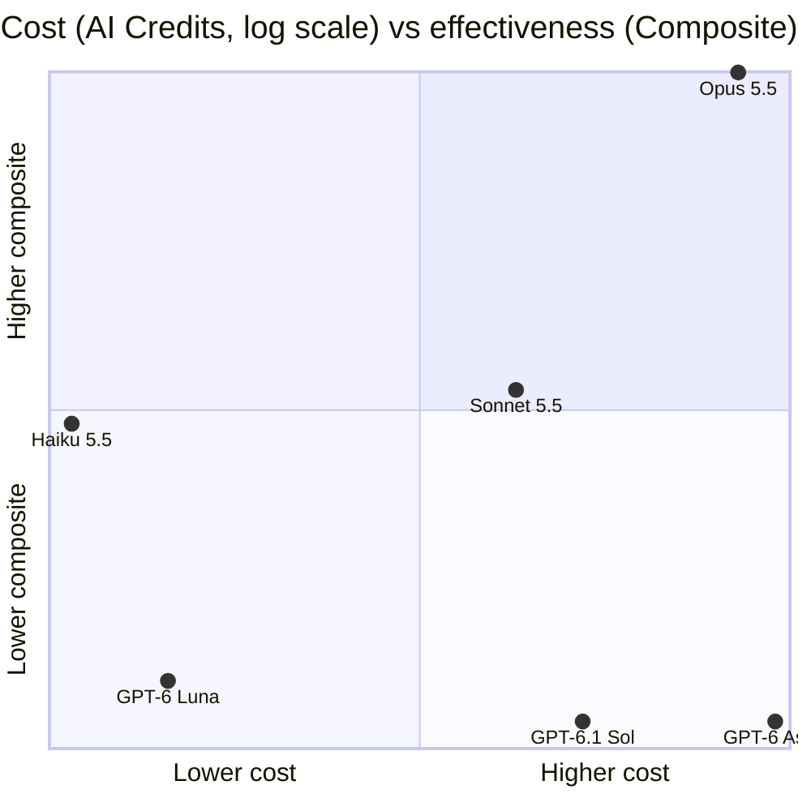

## Question

Original question: How does the effectiveness of the new Copilot Fusion compare to direct selection of a model when performing
code reviews in GitHub Copilot?

Revised to: How do the Claude and GPT models stack up for code review in GitHub Copilot?

:::tip

TL;DR spoiler: Fusion selected GPT-6 models over Claude, and Sol and Astra did a shockingly poor job of
reviewing the code, so much so that I will not use Fusion again for code review. Further testing revealed this
to be a GPT-6 problem, not a Copilot Fusion problem, so I will not be using GPT-6 in GitHub Copilotagain for
code reviews. My built-for-Claude prompt was expensive and ineffective, but others' prompts were also
ineffective.

:::

<!-- truncate -->

## Introduction

GitHub unveiled [Copilot Fusion](https://docs.github.com/en/copilot/concepts/models/copilot-fusion) in late
October, 2026. It serves as a model router: you give it the task and the effort level, and it choose the model
to run. Model routing reduces token cost by optimizing LLM selection for the task, often invoking multiple
models in the same long running solution. While [conceptually mature](https://arxiv.org/abs/2502.08773)
(2025), the technique is now gaining in popularity as AI usage costs have increased (anecdotal observation).

My primary coding agent is Claude Code. Frequently, I use GitHub Copilot for code reviews so that I have a
broad range of models to choose from, and to balance my token usage across entry-level subscriptions in both.
For all but the smallest tasks, I run a suite of five reviewers ([`team-pr-review`
skill](https://github.com/Ed-Fi-Alliance-OSS/AI-Tools-for-Ed-Fi-SDLC/blob/main/skills/team-pr-review/SKILL.md)).
Each is assigned to a subagent, and the main thread orchestrates, confirms, and reports the findings back to
me. Typically I am choose a higher-end model, e.g. Claude Opus 5.5 or GPT 5.6 Sol. Sometimes I set the
subagents to a lower model, and if I am not the only reviewer, I might choose a middle tier model (Sonnet 5.5
or GPT-5.6 Terra). Until the experiment reported below, I had not yet tried the GPT-6 class of models.

To date, all of my model routing has been manual, e.g. I select a model for orchestration then tell it which
model to use (if different) for subagents. Given that GitHub Copilot charges for consumption, unlike Claude
Code (with these models), Fusion has the potential for reducing the cost of my code reviews.

:::warning

The experiment documented below is _only_ analyzing code review. Strictly speaking, it has nothing to say
about _coding_ tasks, beyond the comparison of AI credit costs for the "same" workload.

:::

## Approach

Run the following prompt across a matrix of model choices:

> /team-pr-review — PR 1420 checked out at commit `01222687f0acc7be5bff159867aae1b956d4208a`. The PR
> description describes the task; no need to read Jira or a GitHub Issue. Save this prompt and your final
> review as ./round-{n}-{model}.md. Do not post to GitHub.

In the initial runs, all models were left with the default "medium" effort. Models:

- Claude Haiku 5.5
- Claude Sonnet 5.5
- Claude Opus 5.5
- Copilot Fusion high
- Copilot Fusion max
- GPT 6 Luna
- GPT-6 Sol
- GPT-6 Astra

As previously alluded, Copilot Fusion high executed GPT-6 Sol and Copilot Fusion max executed GPT-6 Astra, and
these did not return any results - literally zero results. I continued testing with these models through
manual selection, and gave up on using Copilot Fusion. Furthermore, the original Fusion runs were not anchored
to the specific commit, giving another reason to throw them out.

:::tip

When performing an experiment on a pull request that is still open, the experimental mantra to "keep all but
one variable constant" means one should pin to a specific commit, not to the PR itself.

:::

## Analysis

I combined and deduplicated the findings from six fresh runs, excluding Copilot Fusion. The combined findings
were assigned the highest severity reported by any of the models. There were 47 unique findings: High 2,
Medium 10, Low 29, Nit 6. I asked Claude Opus 5.5 to review all 47 deduplicated findings and provide its
own assessment of the severity. Then, Opus scored the results

- Baseline scale: No-action/Invalid = 0, Nit = 1, Nit-Low = 1.5, Low = 2, Low-Medium = 2.5, Medium = 3. Source
  ratings: Nit = 1, Low = 2, Medium = 3, High = 4.
- Weighting: each finding is weighted by its baseline value, so Medium counts 3, Low 2 and Nit 1. Findings the
  baseline rates No-action or Invalid carry no coverage weight and count as false positives when reported.
- Actionable baseline findings: 42 of 47, total weight 71.5.

Results:

| Rank    | Model             | Findings  | Weighted coverage | Precision     | Severity[^1]        | Bias  | Unique finds  | False positives | Composite |
| ------- | ----------------- | --------- | ----------------- | ------------- | ------------------- | ----- | ------------- | --------------- | --------- |
| 1       | Claude Opus 5.5   | 32        | 53.0 pts (74.1%)  | 93.8% (30/32) | 23/30 (77%) / 30/30 | +0.20 | 16 (28.5 pts) | 2 (C5, C41)     | 49.0      |
| 2       | Claude Sonnet 5.5 | 21        | 30.0 pts (42.0%)  | 90.5% (19/21) | 5/19 (26%) / 18/19  | +0.74 | 7 (9.5 pts)   | 2 (C20, C33)    | 26.0      |
| 3       | Claude Haiku 5.5  | 15        | 25.5 pts (35.7%)  | 93.3% (14/15) | 5/14 (36%) / 13/14  | +0.68 | 3 (5.0 pts)   | 1 (C46)         | 23.5      |
| 4       | GPT-6 Luna        | 3         | 5.0 pts (7.0%)    | 100% (3/3)    | 2/3 / 3/3           | +0.33 | 0             | 0               | 5.0       |
| 5 (tie) | GPT-6.1 Sol       | 1         | 2.0 pts (2.8%)    | 100% (1/1)    | 1/1 / 1/1           | 0.00  | 0             | 0               | 2.0       |
| 5 (tie) | GPT-6 Astra       | 1         | 2.0 pts (2.8%)    | 100% (1/1)    | 1/1 / 1/1           | 0.00  | 0             | 0               | 2.0       |

[^1]: exact / within one step

Definitions:

- Precision: share of reported findings whose baseline is above No-action.
- Bias: mean of (source rating - baseline) over actionable findings. Positive means over-rating.
- Composite: weighted coverage points minus 2 points per false positive. It is a judgment call, not a validated measure.

The following table lists the costs in GitHub Copilot's AI credits, from lowest to highest. As of November,
2026, my Enterprise account charges $0.0026 / AI credit.

| Model             | AI Credits | Input Tokens | Output Tokens | $ Cost   |
| ----------------- | ---------- | ------------ | ------------- | -------- |
| Claude Haiku 5.5  | 7.26       | 1.7m         | 51.4k         | 0.018876 |
| GPT-6 Luna        | 14.63      | 5.9m         | 77.4k         | 0.038038 |
| Claude Sonnet 5.5 | 173.72     | 3.6m         | 37.3k         | 0.451672 |
| GPT-6.1 Sol       | 280.92     | 8.4m         | 38.1k         | 0.730392 |
| Claude Opus 5.5   | 848.05     | 13.7m        | 105.3k        | 2.204930 |
| GPT-6 Astra       | 1126.19    | 5.4m         | 24.8k         | 2.928094 |

The following chart compares cost to effectiveness in a scaled quadrant; admittedly, for the size of the
experiment, a chart was unnecessary.

## Discussion

Claude Opus 5.5's interpretation of the data:

> - Haiku is the clear value pick: about 48% of Opus's composite for under 1% of its cost.
> - Opus is the most effective but costs about 5x Sonnet for roughly 1.9x the composite.
> - Sol and Astra are expensive and contributed one finding each, so they sit at the bottom right.
> - Composite is a single-run measure, and the review prompts and scope differed across rounds, so treat the
>   cost comparison as indicative only.

### GPT-6 Models

To me, it was simply shocking that Sol and Astra would perform so poorly; it was also interesting that they
detected _nothing_ when run with Copilot Fusion, but did detect one finding when run alone. (However, this may
finding may have come through a commit that was pushed after the initial Fusion testing). And even more
surprising that Luna _did_ uncover three findings, all of which were deemed legitimate.

What does this tell me about these GPT-6 models? That Sol and Astra, in the context of GitHub Copilot, are not
suitable for code review using my prompts. They may be suitable using someone else's prompts, or when used in
the context of OpenAI's Codex.

Also of note: every run of Sol or Astra loaded one or more skills unexpectedly, sometimes four or five of
them. It is entirely possible that these extra skills confused the models.

What about others' prompts? I tried two: [Addy
Osmani's](https://github.com/addyosmani/agent-skills/blob/main/skills/code-review-and-quality/SKILL.md), and a
colleague's:

> Provide a code review of  PR 1420 checked out at commit `01222687f0acc7be5bff159867aae1b956d4208a` focused
> on correctness and simplicity. Check for duplicated and dead code. Ensure the code provides the simplest
> responsible solution. Check for scope creep. Do not run tests. Save this prompt and your final review as
> ./reviews/round-21-astra6.md. Do not post to GitHub.

Interestingly, my colleague's prompt with Astra _did_ get four findings, although in the skill list I see that
it also pulled in Addy Osmani's `/code-review-and-quality` (also, unnecessarily, `/graphify` and
`/using-agent-skills`). That review cost 409.54 credits - far lower than my own five-part prompt.

Next I tried turning from the default medium effort to high effort. For only 471.93 credits, Astra gave me two
blocking findings (no severity rating) and two nice-to-fix findings. Improvement.

Finally, I replayed my five-part review with high effort. 2240.67 AIC! Ouch, double the cost as with high
effort. Outcome: a single medium finding, and did not rediscover the low finding from the earlier Astra-medium
run with my prompt.

### Claude Models

The Claude models were very effective. My "team-pr-review" prompt was originally developed in a Claude model,
so perhaps it should not be surprising that it is more effective in these models.

Opus 5.5 was substantially more effective than Sonnet 5.5, which was marginally more effective than Haiku 5.5.

The cost effectiveness of this latest Haiku model is a second surprise. Haiku overweighed some findings, and
it had a few unique findings. What if we combine the independent Haiku 5.5 and Sonnet 5.5 findings - how do
they compare to Opus 5.5? Combined gets a composite score of 35.0, which is mid-way between the Sonnet 5.5 and
Opus 5.5 scores. It does so with a combined cost of 180.98 AI credits, which is 21% of the cost of the Opus
5.5 review.

Were Haiku's unique findings of real interest? It had two findings rated at Medium; in the meta review,
one of those was downgraded to Low, but the other stood and was _not_ in Sonnet.

Would Haiku + Sonnet have been effective compared to Opus alone? Opus alone had three additional Medium
findings. After re-review, two of those were bumped down to Low, and one of them was rated Low-Medium.
Therefore, with a sample size of one, the Haiku + Sonnet combination was nearly as effective as Opus alone.

### Comparison to Claude Code

What happens when running the same prompt in Claude Code with Opus 5.5? Composite score of 42.5 - lower than
the Copilot + Opus 5.5 run, but higher than Haiku + Sonnet. Claude Code had eight new findings that are not in
the baseline, and missed nine; if the new findings were incorporated, the composite scores would be much
closer, perhaps even reversed.

Claude's `/usage` lists a dollar cost on some unknown (to me) basis, which is not what I actually pay. That
cost was $11.18, 5x the actual cost of the Copilot + Opus review. Claude Code's run took approx 26 min
compared to 35 min in GitHub Copilot. Copilot reported 13.7 million input tokens compared to Claude Code's
22.8 million input tokens (including cache reads). The actual cost is not apples-to-apples because of the way
that Claude Code subscriptions work, so a cost comparison is not appropriate.

### Other Models

... ran out of credits for November, so comparison of other models will need to wait until December.

## Conclusion

For the past year, most of my work in GitHub Copilot has been for code reviews. To my recollection, GPT 5.6
models regularly returned review results, unlike the GPT 6 higher models in the above results.

Due to a limited budget, this review has very few data points. It is not a scientifically valid comparison
with statistical proof that one technique is better than the other.

Claude Opus 5.5 in GitHub Copilot is highly effective. At this cost, I can run about 17 reviews per month,
which is more than the norm for me[^2]. If I am the _only_ reviewer, Copilot + Opus 5.5 is probably a good
choice. Copilot + Sonnet and Copilot + Haiku will also be effective, at a lower cost, which may mean it is a
better choice on the rare occasions when I am performing a secondary review, rather than the primary review.

[^2]: since moving into management a few years ago, I am not frequently part of a ticket's review cycle.

Although perhaps unfair, finding an effective prompting strategy for Sol or Astra would be costly. The
experiments analyzed above do not give me any confidence that such an investigation would lead to anything
other than burned AI credits.
