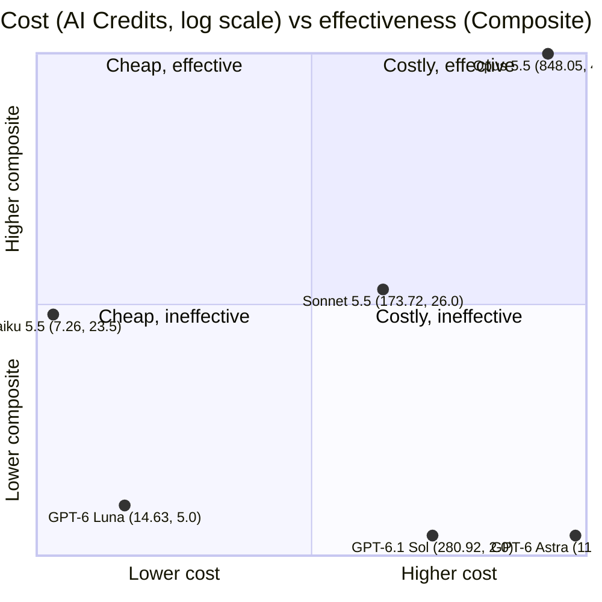

## Question

How does the effectiveness of the new Copilot Fusion compare to direct selection of a model when performing
code reviews in GitHub Copilot?

## Introduction

GitHub unveiled [Copilot Fusion](https://docs.github.com/en/copilot/concepts/models/copilot-fusion) in late
October, 2026. It serves as a model router: you give it the task and the effort level, and it choose the model
to run. Model routing reduces token cost by optimizing LLM selection for the task, often invoking multiple
models in the same long running solution. While [conceptually mature](https://arxiv.org/abs/2502.08773)
(2025), the technique is now gaining in popularity as AI usage costs have increased (anecdotal observation).

My primary coding agent is Claude Code. Frequently, I use GitHub Copilot for code reviews so that I have a
broad range of models to choose from, and to balance my token usage across entry-level subscriptions in both.
For all but the smallest tasks, I run a suite of five reviewers ([`team-pr-review`
skill](https://github.com/Ed-Fi-Alliance-OSS/AI-Tools-for-Ed-Fi-SDLC/blob/main/skills/team-pr-review/SKILL.md)).
Each is assigned to a subagent, and the main thread orchestrates, confirms, and reports the findings back to
me. Typically I am choose a higher-end model, e.g. Claude Opus 5.5 or GPT 5.6 Sol. Sometimes I set the
subagents to a lower model, and if I am not the only reviewer, I might choose a middle tier model (Sonnet 5.5
or GPT-5.6 Terra). Until the experiment reported below, I had not yet tried the GPT-6 class of models.

To date, all of my model routing has been manual, e.g. I select a model for orchestration then tell it which
model to use (if different) for subagents. Given that GitHub Copilot charges for consumption, unlike Claude
Code (with these models), Fusion has the potential for reducing the cost of my code reviews.

:::warning

The experiment documented below is _only_ analyzing code review. Strictly speaking, it has nothing to say
about _coding_ tasks, beyond the comparison of AI credit costs for the "same" workload.

:::

## Approach

Run the following prompt across a matrix of model choices:

> /team-pr-review — PR 1420 checked out at commit `01222687f0acc7be5bff159867aae1b956d4208a`. The PR description describes the task; no need to read Jira or a GitHub Issue. Save this prompt and your final review as ./round-1-sonnet55.md. Do not post to GitHub.

Initially, all models were left with the default "medium" effort

## Analysis

## Discussion

## Conclusion
