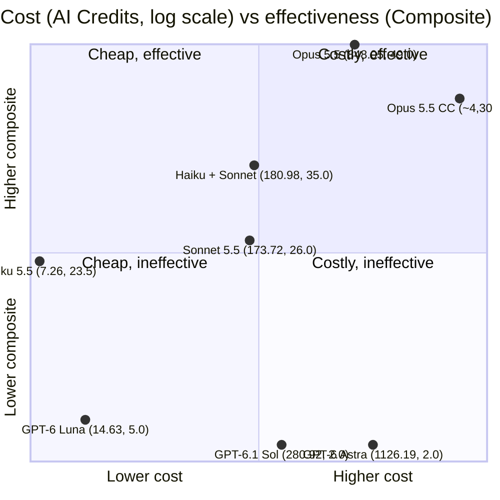

# Model Comparison: Round Reviews vs Meta-Review Baseline

## Scope and method

- Baseline: the "Reassessed" severity in `reviews/meta-review.md` for findings C1-C47.
- Data: per-finding ratings from the "Sources (rating)" column of `reviews/combined-reviews.md`. The round files were not re-read for the per-finding data. I only opened `round-2-sol61.md` and `round-4-astra.md` to confirm that each really contains a single finding (C1) and no findings that the combined list dropped.
- Baseline scale: No-action/Invalid = 0, Nit = 1, Nit-Low = 1.5, Low = 2, Low-Medium = 2.5, Medium = 3. Source ratings: Nit = 1, Low = 2, Medium = 3, High = 4.
- Weighting: each finding is weighted by its baseline value, so Medium counts 3, Low 2 and Nit 1. Findings the baseline rates No-action or Invalid carry no coverage weight and count as false positives when reported.
- Actionable baseline findings: 42 of 47, total weight 71.5. The five excluded are C5, C20, C33, C41 and C46.

## Summary

| Rank    | Model                  | Findings reported | Weighted coverage | Precision     | Severity[^1]        | Bias  | Unique finds  | False positives   | Composite |
| ------- | ---------------------- | ----------------- | ----------------- | ------------- | ------------------- | ----- | ------------- | ----------------- | --------- |
| 1       | Claude Opus 5.5        | 32                | 53.0 pts (74.1%)  | 93.8% (30/32) | 23/30 (77%) / 30/30 | +0.20 | 16 (28.5 pts) | 2 (C5, C41)       | 49.0      |
| 2       | Opus 5.5 (Claude Code) | 26[^2]            | 44.5 pts (62.2%)  | 96.2% (25/26) | 9/25 (36%) / 23/25  | +0.62 | 0[^2]         | 1 (C41)           | 42.5      |
| 3       | Haiku 5.5 + Sonnet 5.5 | 28                | 41.0 pts (57.3%)  | 89.3% (25/28) | 8/25 (32%) / 23/25  | +0.72 | 11 (16.5 pts) | 3 (C20, C33, C46) | 35.0      |
| 4       | Claude Sonnet 5.5      | 21                | 30.0 pts (42.0%)  | 90.5% (19/21) | 5/19 (26%) / 18/19  | +0.74 | 7 (9.5 pts)   | 2 (C20, C33)      | 26.0      |
| 5       | Claude Haiku 5.5       | 15                | 25.5 pts (35.7%)  | 93.3% (14/15) | 5/14 (36%) / 13/14  | +0.68 | 3 (5.0 pts)   | 1 (C46)           | 23.5      |
| 6       | GPT-6 Luna             | 3                 | 5.0 pts (7.0%)    | 100% (3/3)    | 2/3 / 3/3           | +0.33 | 0             | 0                 | 5.0       |
| 7 (tie) | GPT-6.1 Sol            | 1                 | 2.0 pts (2.8%)    | 100% (1/1)    | 1/1 / 1/1           | 0.00  | 0             | 0                 | 2.0       |
| 7 (tie) | GPT-6 Astra            | 1                 | 2.0 pts (2.8%)    | 100% (1/1)    | 1/1 / 1/1           | 0.00  | 0             | 0                 | 2.0       |

[^1]: exact / within one step
[^2]: Findings that map to C1-C47 only. The round also reported 8 findings that are not in the baseline and are unscored. See "Opus 5.5 (Claude Code) scoring" below.

The combined row is a hypothetical merged report from the Haiku and Sonnet runs, scored in "Combined Haiku + Sonnet scoring" below. Its figures are not the sum of the two rows above, because overlapping findings count once and the higher rating is kept.

The Opus 5.5 (Claude Code) row is `round-25-opus-cc.md`, run through Claude Code instead of GitHub Copilot. The baseline was built before this round, so every C-ID it found was already found by an earlier source, and its unique-finds count is 0 by construction. The unique-finds column for the other rows is still measured against the original six sources only.

Definitions:

- Precision: share of reported findings whose baseline is above No-action.
- Bias: mean of (source rating - baseline) over actionable findings. Positive means over-rating.
- Composite: weighted coverage points minus 2 points per false positive. It is a judgment call, not a validated measure.

Now Cost, lowest to highest

| Model                                    | AI Credits | Input Tokens | Output Tokens |
| ---------------------------------------- | ---------- | ------------ | ------------- |
| Claude Haiku 5.5                         | 7.26       | 1.7m         | 51.4k         |
| GPT-6 Luna                               | 14.63      | 5.9m         | 77.4k         |
| Claude Sonnet 5.5                        | 173.72     | 3.6m         | 37.3k         |
| Claude Haiku 5.5 + Sonnet 5.5 (combined) | 180.98     | 5.3m         | 88.7k         |
| GPT-6.1 Sol                              | 280.92     | 8.4m         | 38.1k         |
| Claude Opus 5.5                          | 848.05     | 13.7m        | 105.3k        |
| GPT-6 Astra                              | 1126.19    | 5.4m         | 24.8k         |
| Claude Opus 5.5 (Claude Code)            | ~4,300[^3] | 22.8m        | 129.6k        |

[^3]: Claude Code reported $11.18, not AI Credits. The credit figure converts it at $0.0026 per AI credit, the Copilot Enterprise rate quoted in the blog post. Claude Code's figure is an API list-price estimate, so the conversion is approximate. Input is 103.3k uncached + 22.0m cache read + 710.8k cache write.

### Cost versus effectiveness

Mermaid has no true scatter plot, so this is a quadrant chart. Both axes are scaled to 0-1:

- X (cost) is log10(AI Credits), rescaled so 6.3 credits maps to 0 and 6,300 credits maps to 1. A log scale is needed because costs span 7 to about 4,300 credits. The upper bound was raised from 1,259 to fit the Claude Code run, so every x value changed from the earlier version of this chart.
- Y (effectiveness) is the composite score divided by the best score (Opus, 49.0).
- The combined entry uses the same formulas: x = 0.49 and y = 35.0 / 49.0 = 0.71. Its x value is almost the same as Sonnet's.

| Model                                    | AI Credits | Composite | Composite per 100 credits |
| ---------------------------------------- | ---------- | --------- | ------------------------- |
| Claude Haiku 5.5                         | 7.26       | 23.5      | 323.7                     |
| GPT-6 Luna                               | 14.63      | 5.0       | 34.2                      |
| Claude Haiku 5.5 + Sonnet 5.5 (combined) | 180.98     | 35.0      | 19.3                      |
| Claude Sonnet 5.5                        | 173.72     | 26.0      | 15.0                      |
| Claude Opus 5.5                          | 848.05     | 49.0      | 5.8                       |
| Claude Opus 5.5 (Claude Code)            | ~4,300     | 42.5      | 1.0                       |
| GPT-6.1 Sol                              | 280.92     | 2.0       | 0.7                       |
| GPT-6 Astra                              | 1126.19    | 2.0       | 0.2                       |

Reading the chart:

- Haiku is the clear value pick: about 48% of Opus's composite for under 1% of its cost.
- Opus is the most effective but costs about 5x Sonnet for roughly 1.9x the composite.
- Combining Haiku and Sonnet reaches about 71% of Opus's composite (35.0 versus 49.0) and 77% of its coverage points (41.0 versus 53.0) for about 21% of its cost (180.98 versus 848.05 credits). That is 19.3 composite per 100 credits against 5.8 for Opus. Adding Haiku to Sonnet costs 7.26 credits (4%) and lifts the composite by 9.0 points. The pair still trails Opus, which has 17 actionable findings the pair misses (30.5 pts), including the test-coverage gaps C25-C31. The pair finds 12 that Opus does not (18.5 pts), so the two approaches are partly complementary.
- The same model through Claude Code (round 25) scored 42.5 against 49.0 through Copilot, at about 5x the cost ($11.18 versus $2.20). The two Opus runs share 22 actionable C-IDs, so a second run of the same model mostly repeats the first. Round 25 also reported 8 findings outside the baseline, which would raise its score if the baseline accepted them.
- Sol and Astra are expensive and contributed one finding each, so they sit at the bottom right.
- Composite is a single-run measure, and the review prompts and scope differed across rounds, so treat the cost comparison as indicative only.

## Per-model profiles

### Claude Opus 5.5 (`round-5-opus.md`): best overall

- Reported 30 of 42 actionable findings and covers 74% of the baseline weight. No other source is close.
- Most accurate on severity: 77% exact, every rating within one step of the baseline, and the smallest bias (+0.20). Its five over-ratings are the Mediums it gave to C13, C14 and C25 (baseline Low) and the Lows it gave to C16 and C27 (baseline Nit).
- Found 16 actionable findings nobody else did, including C42 (no changelog entry), which the baseline rates Low-Medium, and a wide set of test-coverage gaps (C25-C31).
- Two weaker items: C5 (Keycloak revokes nothing) is by design, and C41 (duplicated fixtures) matches the existing pattern and was marked "no action" in its own text.
- Missed, among others: C8, C10, C11, C15, C23, C24, C44 and C45, which other sources found.

### Claude Opus 5.5 through Claude Code (`round-25-opus-cc.md`): second, broad and precise but costly

- 26 findings map to the baseline, 25 of them actionable, for 62% weighted coverage (44.5 of 71.5 points). The only false positive is C41 (duplicated fixtures), which the round itself called "not blocking". Opus through Copilot was marked down for the same finding.
- Highest precision of any multi-finding source (96.2%).
- Rates higher than the Copilot Opus run: 36% exact versus 77%, and bias +0.62 versus +0.20. It rated 11 findings Medium, and the baseline keeps only 2 of them (C2, C4) at Medium. C3 (scenario count, bundled into the Medium vendor-delete item) and C21 (logging, Medium versus Nit-Low) are the two ratings more than one step off.
- Against the Copilot Opus run, it adds C10, C24 and C45, and misses C1, C5, C12, C14, C22, C31, C37, C43 and C47. It finds every Medium the baseline keeps (C2, C4) and C42.
- 8 findings have no C-ID (listed in the scoring section), including a fail-open default for clients with no `ApiClient` row and an out-of-date admin guide. They are unscored, not false positives.
- Cost is $11.18 (about 4,300 credits at the Copilot rate), roughly 5x the Copilot Opus run.

### Claude Haiku 5.5 + Sonnet 5.5, combined (`combined-haiku-sonnet.md`): third, cheap and broad

- 28 findings after de-duplication, 25 actionable, 57% weighted coverage (41.0 of 71.5 points). Cost is 180.98 credits, about 4% more than Sonnet alone.
- Eight findings were reported by both models (C2, C3, C6, C7, C11, C13, C19, C21). The rest are split between them, so each model fills gaps in the other: Haiku adds C4, C8, C22, C43, C44 and C45 to Sonnet's set.
- Severity sits between the two models: 32% exact (Sonnet 26%, Haiku 36%) and 23 of 25 within one step. Keeping the higher rating pushes ratings up, so bias is +0.72 (Sonnet +0.74, Haiku +0.68). C8 (High, baseline Low) and C15 (Medium, baseline Nit) are two steps over.
- 11 unique actionable finds (16.5 pts), more than Sonnet (7) and Haiku (3) alone, because C11 is shared by the two but missed by Opus.
- Three false positives (C20, C33, C46), the union of Sonnet's two and Haiku's one. Precision is 89.3%.

### claude-sonnet-5.5 (`round-1-sonnet55.md`): fourth, a good-faith over-rater

- 19 actionable findings, 42% weighted coverage, and the strongest signal on lock handling and logging.
- Systematic over-rating: 12 of 19 findings were rated above the baseline, giving a +0.74 bias. Most were Medium ratings (C6, C7, C9, C13, C15) that the baseline lowered to Low or Nit. Only 26% match exactly, though 18 of 19 are within one step.
- Seven unique actionable finds, including C10 (no lock timeout on reset, delete and un-approval), the only finding of that kind and rated Low-Medium by the baseline. Its other unique finds are mostly Low or Nit (C15, C17, C23, C24, C38, C39).
- Reported C20 (database error text leaks) and C33, which the baseline calls Invalid and No-action. C33 was labelled "no action" by the source itself, so only C20 is a real false claim.
- Self-labelled on C18 as intentional, which agrees with the baseline's view.

### claude-haiku-5.5 (`round-6-haiku55.md`): fifth, high variance

- 14 actionable findings, 36% weighted coverage, and 93% precision.
- Source of both High ratings in the combined list. The baseline downgraded C2 to Medium and C8 to Low, so the model over-rated by one and two steps. Eight findings were over-rated overall (+0.68 bias).
- Real unique value: C8 (the deadlock test cannot tell a deadlock from a timeout) is a valid weakness even though it is only Low, plus C44 and C45. The baseline agreed C8 deserves an elapsed-time assertion.
- One false positive: C46 (injection through `TenantWhereClause`), which the source itself noted is not exploitable.
- Coverage caveat: its security specialist did not review the MSSQL token store or the `UpdateApiClient` wiring.

### gpt-6-luna (`round-3-luna6.md`): narrow but accurate

- Three findings (C6, C7, C16), all valid, all within one step. It rated C6 and C7 at Low, which matches the baseline exactly, while the Medium ratings from rounds 1 and 6 were too high.
- No unique finds and no false positives. Static review only (`dotnet` unavailable).

### gpt-6.1-sol (`round-2-sol61.md`) and GPT-6 Astra (`round-4-astra.md`): single finding each

- Each reported only C1 (the misleading "nothing was deleted" warning after a partial vendor deletion) at Low, which matches the baseline exactly. I confirmed in the round files that this is the only finding in each, so these are not data-extraction gaps.
- Astra's finding includes concrete fix wording and a confidence score. Sol was static-only.
- Both score on precision but contribute almost nothing to coverage. They are tied in the ranking because the data cannot separate them.

## Combined Haiku + Sonnet scoring

### Method

- The combined model is the merged report in `combined-haiku-sonnet.md` (H1-H34), built from `round-6-haiku55.md` and `round-1-sonnet55.md` only.
- Each H-ID was mapped to C-IDs using the round-1 and round-6 source entries in `combined-reviews.md`. The finding set is the union of C-IDs credited to either round, so findings are counted by C-ID, not H-ID. The 34 H-IDs collapse to 28 C-IDs.
- Where both sources rated a C-ID, the higher rating is the combined rating. That is what a merged report shows. A source's own ratings in `combined-reviews.md` were used, not the heading tier.
- Baseline values, weighting, precision, severity, bias, unique finds and composite use the definitions above. Unique means an actionable C-ID found by Haiku or Sonnet and by none of Opus, Luna, Sol or Astra.
- Cost is the sum of the two runs: 7.26 + 173.72 = 180.98 AI Credits, input 1.7m + 3.6m = 5.3m, output 51.4k + 37.3k = 88.7k.

### H to C mapping

| H-ID | C-ID      | H-ID | C-ID | H-ID | C-ID      |
| ---- | --------- | ---- | ---- | ---- | --------- |
| H1   | C2        | H13  | C45  | H25  | C38       |
| H2   | C8        | H14  | C43  | H26  | C3 (part) |
| H3   | C6 and C7 | H15  | C43  | H27  | C23       |
| H4   | C13       | H16  | C19  | H28  | C24       |
| H5   | C4        | H17  | C21  | H29  | C33       |
| H6   | C10       | H18  | C17  | H30  | C46       |
| H7   | C9        | H19  | C18  | H31  | C22       |
| H8   | C15       | H20  | C20  | H32  | C39       |
| H9   | C11       | H21  | C19  | H33  | C19       |
| H10  | C3        | H22  | C37  | H34  | C39       |
| H11  | C21       | H23  | C16  |      |           |
| H12  | C44       | H24  | C21  |      |           |

Mapping notes:

- Every H-ID maps to at least one C-ID, and every C-ID credited to round-1 or round-6 has at least one H-ID. There are no gaps in either direction.
- H3 merges C6 and C7, which the baseline treats as two findings. Both are counted, since both sources reported both.
- H26 (drifted `ApiClientRepository` comment blocks) has no C entry of its own. Round 1 bundled it with the E2E scenario count in C3, and the H list split it out, so it maps to C3 and adds no weight.
- Several H-IDs are folded into one C-ID: C21 (H11, H17, H24), C19 (H16, H21, H33), C43 (H14, H15) and C39 (H32, H34). This is why 34 H findings score as 28.
- H21 (Low) and H33 (Nit) both map to C19. The Sonnet rating used is Low, as in `combined-reviews.md`.
- `combined-haiku-sonnet.md` counts 5 findings found by both sources. By C-ID the overlap is 8: C2, C3, C6, C7, C11, C13, C19 and C21.
- H20, H29 and H30 map to C20, C33 and C46, which the baseline rates Invalid or No-action. They are the three false positives.

### Per-finding working

Ratings use the numeric scale (Nit 1, Low 2, Medium 3, High 4). Diff is combined rating minus baseline. S and H are the Sonnet and Haiku ratings.

| C-ID | H-IDs         | Baseline | S   | H   | Combined | Diff | Exact | Within one | Unique         |
| ---- | ------------- | -------- | --- | --- | -------- | ---- | ----- | ---------- | -------------- |
| C2   | H1            | 3        | 3   | 4   | 4        | +1   | no    | yes        | no             |
| C3   | H10, H26      | 1        | 2   | 2   | 2        | +1   | no    | yes        | no             |
| C4   | H5            | 3        |     | 3   | 3        | 0    | yes   | yes        | no             |
| C6   | H3            | 2        | 3   | 3   | 3        | +1   | no    | yes        | no             |
| C7   | H3            | 2        | 3   | 3   | 3        | +1   | no    | yes        | no             |
| C8   | H2            | 2        |     | 4   | 4        | +2   | no    | no         | yes            |
| C9   | H7            | 2        | 3   |     | 3        | +1   | no    | yes        | no             |
| C10  | H6            | 2.5      | 3   |     | 3        | +0.5 | no    | yes        | yes            |
| C11  | H9            | 2        | 2   | 2   | 2        | 0    | yes   | yes        | yes            |
| C13  | H4            | 2        | 3   | 3   | 3        | +1   | no    | yes        | no             |
| C15  | H8            | 1        | 3   |     | 3        | +2   | no    | no         | yes            |
| C16  | H23           | 1        | 2   |     | 2        | +1   | no    | yes        | no             |
| C17  | H18           | 1        | 2   |     | 2        | +1   | no    | yes        | yes            |
| C18  | H19           | 2        | 2   |     | 2        | 0    | yes   | yes        | no             |
| C19  | H16, H21, H33 | 1        | 2   | 2   | 2        | +1   | no    | yes        | no             |
| C21  | H11, H17, H24 | 1.5      | 2   | 2   | 2        | +0.5 | no    | yes        | no             |
| C22  | H31           | 1        |     | 1   | 1        | 0    | yes   | yes        | no             |
| C23  | H27           | 2        | 2   |     | 2        | 0    | yes   | yes        | yes            |
| C24  | H28           | 1        | 2   |     | 2        | +1   | no    | yes        | yes            |
| C37  | H22           | 1        | 2   |     | 2        | +1   | no    | yes        | no             |
| C38  | H25           | 1        | 2   |     | 2        | +1   | no    | yes        | yes            |
| C39  | H32, H34      | 1        | 1   |     | 1        | 0    | yes   | yes        | yes            |
| C43  | H14, H15      | 2        |     | 2   | 2        | 0    | yes   | yes        | no             |
| C44  | H12           | 2        |     | 2   | 2        | 0    | yes   | yes        | yes            |
| C45  | H13           | 1        |     | 2   | 2        | +1   | no    | yes        | yes            |
| C20  | H20           | 0        | 2   |     |          |      |       |            | false positive |
| C33  | H29           | 0        | 2   |     |          |      |       |            | false positive |
| C46  | H30           | 0        |     | 1   |          |      |       |            | false positive |

Totals:

- Findings reported: 28 (25 actionable, 3 false positives).
- Weighted coverage: 41.0 points, which is 57.3% of 71.5. Cross-check: Sonnet 30.0 + Haiku 25.5 - 14.5 overlap (C2, C3, C6, C7, C11, C13, C19, C21) = 41.0.
- Precision: 25/28 = 89.3%.
- Severity: 8 exact (32%), 23 within one (92%). The two misses are C8 and C15. Half-step baselines (C10, C21) count as within one but never exact.
- Bias: the sum of the diffs is +18.0, so 18.0 / 25 = +0.72.
- Unique finds: 11 (C8, C10, C11, C15, C17, C23, C24, C38, C39, C44, C45), worth 16.5 points. Cross-check: Sonnet 9.5 + Haiku 5.0 + C11 (2.0, shared) = 16.5.
- Composite: 41.0 - 2 x 3 = 35.0. Per 100 credits: 35.0 / 180.98 x 100 = 19.3.
- Rank: third, after Opus (49.0) and Opus through Claude Code (42.5), and ahead of Sonnet (26.0).

## Opus 5.5 (Claude Code) scoring

### Method

- Source: `round-25-opus-cc.md`. Each finding was mapped by hand to the C-IDs in `combined-reviews.md`, using the same baseline values, weighting and definitions as above.
- The rating used is the one on the round's own bullet. Where one bullet bundles several C-IDs, each C-ID gets that bullet's rating. This is why C3 (scenario count, bundled into the Medium vendor-delete item) scores as Medium.
- Sub-points that repeat another bullet (the Nit on audit users, which repeats the Medium logging item) are not counted again.
- Findings with no matching C-ID are listed but not scored, because the baseline has no rating for them.

### Per-finding working

| Round-25 finding (rating)                                         | C-ID | Baseline | Rating | Diff | Exact | Within one |
| ----------------------------------------------------------------- | ---- | -------- | ------ | ---- | ----- | ---------- |
| Vendor-delete work undescribed; "keycloak mode is unchanged" (M)  | C2   | 3        | 3      | 0    | yes   | yes        |
| Same bullet: PR body says five scenarios, there are six (M)       | C3   | 1        | 3      | +2   | no    | no         |
| Orphaned credentials, no way to find them (M)                     | C4   | 3        | 3      | 0    | yes   | yes        |
| PostgreSQL 40P01 answers 500 (M)                                  | C6   | 2        | 3      | +1   | no    | yes        |
| SQL Server lifecycle vs sweep deadlock answers 500 (M)            | C9   | 2        | 3      | +1   | no    | yes        |
| Re-validation copied into both engines (M)                        | C13  | 2        | 3      | +1   | no    | yes        |
| Three lifecycle paths take the lock differently (M)               | C35  | 2        | 3      | +1   | no    | yes        |
| Third copy of the `ClientDeleteResult` mapping (M)                | C40  | 2        | 3      | +1   | no    | yes        |
| Revocations and `ClientChanged` refusals hard to trace (M)        | C21  | 1.5      | 3      | +1.5 | no    | no         |
| No changelog entry (M)                                            | C42  | 2.5      | 3      | +0.5 | no    | yes        |
| No test of un-approval lock order vs claim-set rename (M)         | C25  | 2        | 3      | +1   | no    | yes        |
| Un-approval reads `ClientUuid` before locking (L)                 | C34  | 1        | 2      | +1   | no    | yes        |
| PostgreSQL `RedemptionDate` local time vs UTC (L)                 | C45  | 1        | 2      | +1   | no    | yes        |
| 5 s lock timeout applies only to grants (L)                       | C10  | 2.5      | 2      | -0.5 | no    | yes        |
| Nullable transaction parameter (L)                                | C16  | 1        | 2      | +1   | no    | yes        |
| `IUnapprovalTokenRevocation` in the Repositories namespace (L)    | C36  | 2        | 2      | 0    | yes   | yes        |
| ~3.2k lines of mirrored fixtures (L)                              | C41  | 0        | 2      |      |       |            |
| 409 description blames only concurrency (L)                       | C19  | 1        | 2      | +1   | no    | yes        |
| Ambiguous un-approval returns a generic 500 (L)                   | C18  | 2        | 2      | 0    | yes   | yes        |
| C-2 hand-runs repository statements (L)                           | C27  | 1        | 2      | +1   | no    | yes        |
| Lock-timeout and deadlock tests use limit 5 only (L)              | C26  | 2        | 2      | 0    | yes   | yes        |
| Cross-tenant un-approval test uses the no-op participant (L)      | C28  | 2        | 2      | 0    | yes   | yes        |
| Ambiguous un-approval branch has only a positive test (L)         | C29  | 2        | 2      | 0    | yes   | yes        |
| Vendor-delete failure paths untested (L)                          | C30  | 2        | 2      | 0    | yes   | yes        |
| C-3 probe budget 3 s against a 5 s lock timeout (L)               | C32  | 1        | 2      | +1   | no    | yes        |
| E2E 04 and 05 not in the SQL Server lane (Nit)                    | C24  | 1        | 1      | 0    | yes   | yes        |

Mapping notes:

- C25 is a loose match. The baseline item is un-approval racing a grant; round 25 asks for un-approval racing a claim-set rename. Both are untested un-approval lock-order cases.
- C30 is a loose match. The baseline item is repository failure paths; round 25 names the module-level lock-failure and pre-read paths of the same vendor delete.
- C18 matches by citation: both cite the ambiguous un-approval branch at `ApiClientModule.cs:1338-1351`.
- The Medium deadlock bullet also asks for fixtures where the lifecycle side loses the deadlock. That is not C7 (the PostgreSQL grant deadlock test), so C7 is not credited.

Unscored findings with no C-ID:

| Finding                                                                                   | Rating |
| ----------------------------------------------------------------------------------------- | ------ |
| Keycloak `DeleteClientAsync` logs a 404 at Error with a stack trace on retry (part of M1) | Medium |
| Un-approval block lengthens the ~300-line `UpdateApiClient`; duplicate not-found check    | Medium |
| Admin guide implies un-approval or deletion cuts off access immediately                   | Medium |
| `COALESCE(..., true)` treats a client with no `ApiClient` row as approved (fails open)    | Low    |
| `CONFIGURATION.md` and `DOCKER.md` say a limit below 1 disables enforcement               | Low    |
| Docs don't say a retried delete answers 404 once the first committed                      | Nit    |
| `TokenRevocationStartupTests` reads a compiler-generated field by reflection              | Nit    |
| Reset and delete catch blocks don't log the client id                                     | Nit    |

Totals:

- Findings reported: 26 mapped (25 actionable, 1 false positive), plus 8 unscored.
- Weighted coverage: 44.5 points, which is 62.2% of 71.5.
- Precision: 25/26 = 96.2%.
- Severity: 9 exact (36%), 23 within one (92%). The two misses are C3 and C21.
- Bias: the sum of the diffs is +15.5, so 15.5 / 25 = +0.62.
- Composite: 44.5 - 2 x 1 = 42.5. Per 100 credits: 42.5 / 4,300 x 100 = 1.0.
- Rank: second, after Opus through Copilot (49.0) and ahead of the combined Haiku + Sonnet entry (35.0).

## Observations across models

- Over-rating is common, and nobody under-rated. Every source's bias is positive, so the baseline is consistently more lenient than every reviewer. Part of this reflects the baseline's habit of downgrading design and test-gap findings to Low.
- The two High ratings both came from one model (haiku), and both were downgraded.
- Coverage is concentrated: Opus supplied 18 findings that no other source reported (16 actionable), against 9 for Sonnet and 4 for Haiku.
- No reviewer reported the more important items alone. C2 and C4, the only two findings kept at Medium, were reported by Opus and Haiku (C2 also by Sonnet).

## Limitations

- The baseline is itself an AI re-assessment by Sonnet 5.5, so it may favour its own family's rating habits (round 1 in particular). It also leans toward downgrading. Treat "bias" as relative to the baseline, not as truth.
- C28, C29, C30, C35 and C39 were only spot-checked by the baseline's agents, and C15 and C33 were not inspected in detail. Their baseline ratings are less certain.
- Coverage depends on the deduplication in `combined-reviews.md`. A finding merged into another would credit only the surviving ID.
- Prompts and scope differed across rounds. `round-2` and `round-3` were static-only, and `round-5` was the largest source. Findings per model are therefore not a controlled test of model quality.
- C18 is a product decision, not a severity call. It is scored on its Low rating only.
- Round 25 was scored against a baseline built without it. Its 8 unmatched findings are unscored, and its C-ID mapping was done by hand (C25 and C30 are loose matches). Its cost is converted from dollars, so its position on the cost axis is approximate.
- The combined entry is a post-hoc merge, not a run. A real merged report would also cost some reviewer time to de-duplicate, which is not in the credit total. Its ratings are the higher of the two sources, so its bias and severity figures depend on that choice.
- The composite weights are arbitrary. Opus leads under any reasonable weighting, but the order of the lower ranks (especially Sonnet versus Haiku) is sensitive to the false-positive penalty and the over-rating treatment.
