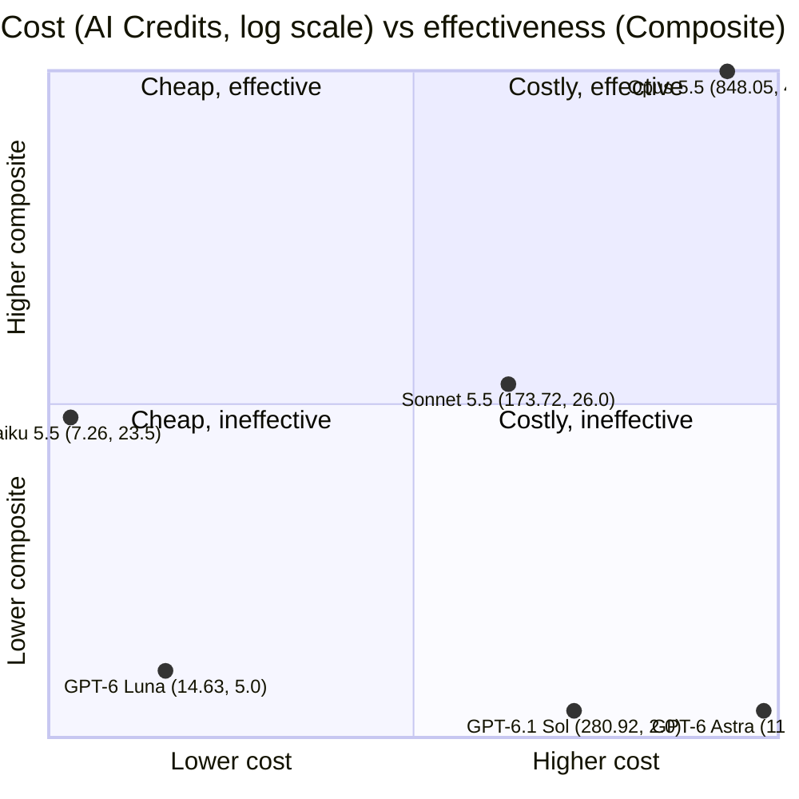

# Model Comparison: Round Reviews vs Meta-Review Baseline

## Scope and method

- Baseline: the "Reassessed" severity in `reviews/meta-review.md` for findings C1-C47.
- Data: per-finding ratings from the "Sources (rating)" column of `reviews/combined-reviews.md`. The round files were not re-read for the per-finding data. I only opened `round-2-sol61.md` and `round-4-astra.md` to confirm that each really contains a single finding (C1) and no findings that the combined list dropped.
- Baseline scale: No-action/Invalid = 0, Nit = 1, Nit-Low = 1.5, Low = 2, Low-Medium = 2.5, Medium = 3. Source ratings: Nit = 1, Low = 2, Medium = 3, High = 4.
- Weighting: each finding is weighted by its baseline value, so Medium counts 3, Low 2 and Nit 1. Findings the baseline rates No-action or Invalid carry no coverage weight and count as false positives when reported.
- Actionable baseline findings: 42 of 47, total weight 71.5. The five excluded are C5, C20, C33, C41 and C46.

## Summary

| Rank    | Model             | Findings reported | Weighted coverage | Precision     | Severity[^1]        | Bias  | Unique finds  | False positives | Composite |
| ------- | ----------------- | ----------------- | ----------------- | ------------- | ------------------- | ----- | ------------- | --------------- | --------- |
| 1       | Claude Opus 5.5   | 32                | 53.0 pts (74.1%)  | 93.8% (30/32) | 23/30 (77%) / 30/30 | +0.20 | 16 (28.5 pts) | 2 (C5, C41)     | 49.0      |
| 2       | Claude Sonnet 5.5 | 21                | 30.0 pts (42.0%)  | 90.5% (19/21) | 5/19 (26%) / 18/19  | +0.74 | 7 (9.5 pts)   | 2 (C20, C33)    | 26.0      |
| 3       | Claude Haiku 5.5  | 15                | 25.5 pts (35.7%)  | 93.3% (14/15) | 5/14 (36%) / 13/14  | +0.68 | 3 (5.0 pts)   | 1 (C46)         | 23.5      |
| 4       | GPT-6 Luna        | 3                 | 5.0 pts (7.0%)    | 100% (3/3)    | 2/3 / 3/3           | +0.33 | 0             | 0               | 5.0       |
| 5 (tie) | GPT-6.1 Sol       | 1                 | 2.0 pts (2.8%)    | 100% (1/1)    | 1/1 / 1/1           | 0.00  | 0             | 0               | 2.0       |
| 5 (tie) | GPT-6 Astra       | 1                 | 2.0 pts (2.8%)    | 100% (1/1)    | 1/1 / 1/1           | 0.00  | 0             | 0               | 2.0       |

[^1]: exact / within one step

Definitions:

- Precision: share of reported findings whose baseline is above No-action.
- Bias: mean of (source rating - baseline) over actionable findings. Positive means over-rating.
- Composite: weighted coverage points minus 2 points per false positive. It is a judgment call, not a validated measure.

Now Cost, lowest to highest

| Model             | AI Credits | Input Tokens | Output Tokens |
| ----------------- | ---------- | ------------ | ------------- |
| Claude Haiku 5.5  | 7.26       | 1.7m         | 51.4k         |
| GPT-6 Luna        | 14.63      | 5.9m         | 77.4k         |
| Claude Sonnet 5.5 | 173.72     | 3.6m         | 37.3k         |
| GPT-6.1 Sol       | 280.92     | 8.4m         | 38.1k         |
| Claude Opus 5.5   | 848.05     | 13.7m        | 105.3k        |
| GPT-6 Astra       | 1126.19    | 5.4m         | 24.8k         |

### Cost versus effectiveness

Mermaid has no true scatter plot, so this is a quadrant chart. Both axes are scaled to 0-1:

- X (cost) is log10(AI Credits), rescaled so 6.3 credits maps to 0 and 1,259 credits maps to 1. A log scale is needed because costs span 7 to 1,126 credits.
- Y (effectiveness) is the composite score divided by the best score (Opus, 49.0).

| Model | AI Credits | Composite | Composite per 100 credits |
| ----- | ---------- | --------- | ------------------------- |
| Claude Haiku 5.5 | 7.26 | 23.5 | 323.7 |
| GPT-6 Luna | 14.63 | 5.0 | 34.2 |
| Claude Sonnet 5.5 | 173.72 | 26.0 | 15.0 |
| Claude Opus 5.5 | 848.05 | 49.0 | 5.8 |
| GPT-6.1 Sol | 280.92 | 2.0 | 0.7 |
| GPT-6 Astra | 1126.19 | 2.0 | 0.2 |

Reading the chart:

- Haiku is the clear value pick: about 48% of Opus's composite for under 1% of its cost.
- Opus is the most effective but costs about 5x Sonnet for roughly 1.9x the composite.
- Sol and Astra are expensive and contributed one finding each, so they sit at the bottom right.
- Composite is a single-run measure, and the review prompts and scope differed across rounds, so treat the cost comparison as indicative only.

## Per-model profiles

### Claude Opus 5.5 (`round-5-opus.md`): best overall

- Reported 30 of 42 actionable findings and covers 74% of the baseline weight. No other source is close.
- Most accurate on severity: 77% exact, every rating within one step of the baseline, and the smallest bias (+0.20). Its five over-ratings are the Mediums it gave to C13, C14 and C25 (baseline Low) and the Lows it gave to C16 and C27 (baseline Nit).
- Found 16 actionable findings nobody else did, including C42 (no changelog entry), which the baseline rates Low-Medium, and a wide set of test-coverage gaps (C25-C31).
- Two weaker items: C5 (Keycloak revokes nothing) is by design, and C41 (duplicated fixtures) matches the existing pattern and was marked "no action" in its own text.
- Missed, among others: C8, C10, C11, C15, C23, C24, C44 and C45, which other sources found.

### claude-sonnet-5.5 (`round-1-sonnet55.md`): second, a good-faith over-rater

- 19 actionable findings, 42% weighted coverage, and the strongest signal on lock handling and logging.
- Systematic over-rating: 12 of 19 findings were rated above the baseline, giving a +0.74 bias. Most were Medium ratings (C6, C7, C9, C13, C15) that the baseline lowered to Low or Nit. Only 26% match exactly, though 18 of 19 are within one step.
- Seven unique actionable finds, including C10 (no lock timeout on reset, delete and un-approval), the only finding of that kind and rated Low-Medium by the baseline. Its other unique finds are mostly Low or Nit (C15, C17, C23, C24, C38, C39).
- Reported C20 (database error text leaks) and C33, which the baseline calls Invalid and No-action. C33 was labelled "no action" by the source itself, so only C20 is a real false claim.
- Self-labelled on C18 as intentional, which agrees with the baseline's view.

### claude-haiku-5.5 (`round-6-haiku55.md`): third, high variance

- 14 actionable findings, 36% weighted coverage, and 93% precision.
- Source of both High ratings in the combined list. The baseline downgraded C2 to Medium and C8 to Low, so the model over-rated by one and two steps. Eight findings were over-rated overall (+0.68 bias).
- Real unique value: C8 (the deadlock test cannot tell a deadlock from a timeout) is a valid weakness even though it is only Low, plus C44 and C45. The baseline agreed C8 deserves an elapsed-time assertion.
- One false positive: C46 (injection through `TenantWhereClause`), which the source itself noted is not exploitable.
- Coverage caveat: its security specialist did not review the MSSQL token store or the `UpdateApiClient` wiring.

### gpt-6-luna (`round-3-luna6.md`): narrow but accurate

- Three findings (C6, C7, C16), all valid, all within one step. It rated C6 and C7 at Low, which matches the baseline exactly, while the Medium ratings from rounds 1 and 6 were too high.
- No unique finds and no false positives. Static review only (`dotnet` unavailable).

### gpt-6.1-sol (`round-2-sol61.md`) and GPT-6 Astra (`round-4-astra.md`): single finding each

- Each reported only C1 (the misleading "nothing was deleted" warning after a partial vendor deletion) at Low, which matches the baseline exactly. I confirmed in the round files that this is the only finding in each, so these are not data-extraction gaps.
- Astra's finding includes concrete fix wording and a confidence score. Sol was static-only.
- Both score on precision but contribute almost nothing to coverage. They are tied in the ranking because the data cannot separate them.

## Observations across models

- Over-rating is common, and nobody under-rated. Every source's bias is positive, so the baseline is consistently more lenient than every reviewer. Part of this reflects the baseline's habit of downgrading design and test-gap findings to Low.
- The two High ratings both came from one model (haiku), and both were downgraded.
- Coverage is concentrated: Opus supplied 18 findings that no other source reported (16 actionable), against 9 for Sonnet and 4 for Haiku.
- No reviewer reported the more important items alone. C2 and C4, the only two findings kept at Medium, were reported by Opus and Haiku (C2 also by Sonnet).

## Limitations

- The baseline is itself an AI re-assessment by Sonnet 5.5, so it may favour its own family's rating habits (round 1 in particular). It also leans toward downgrading. Treat "bias" as relative to the baseline, not as truth.
- C28, C29, C30, C35 and C39 were only spot-checked by the baseline's agents, and C15 and C33 were not inspected in detail. Their baseline ratings are less certain.
- Coverage depends on the deduplication in `combined-reviews.md`. A finding merged into another would credit only the surviving ID.
- Prompts and scope differed across rounds. `round-2` and `round-3` were static-only, and `round-5` was the largest source. Findings per model are therefore not a controlled test of model quality.
- C18 is a product decision, not a severity call. It is scored on its Low rating only.
- The composite weights are arbitrary. Opus leads under any reasonable weighting, but the order of the lower ranks (especially Sonnet versus Haiku) is sensitive to the false-positive penalty and the over-rating treatment.
